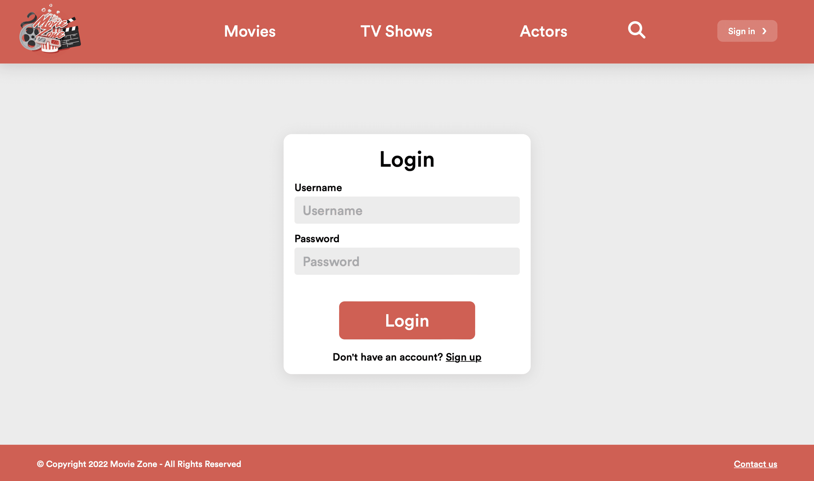
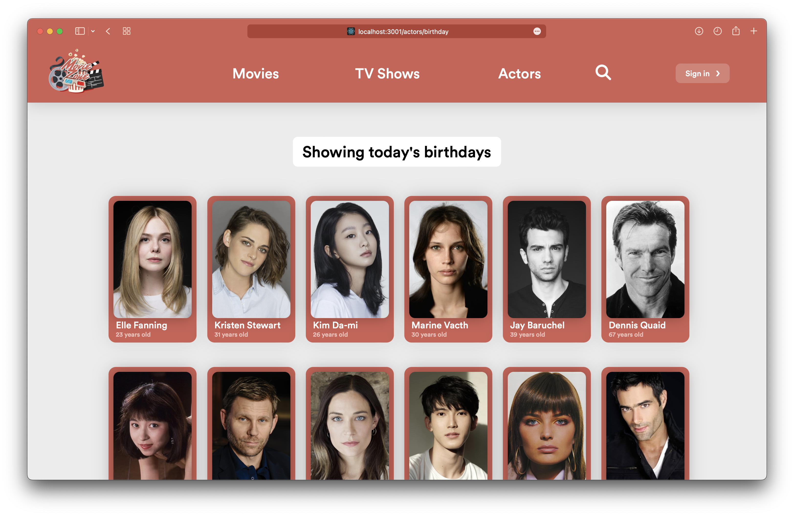
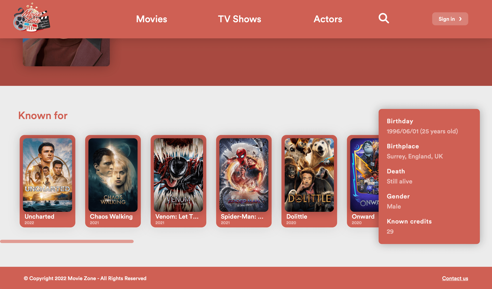
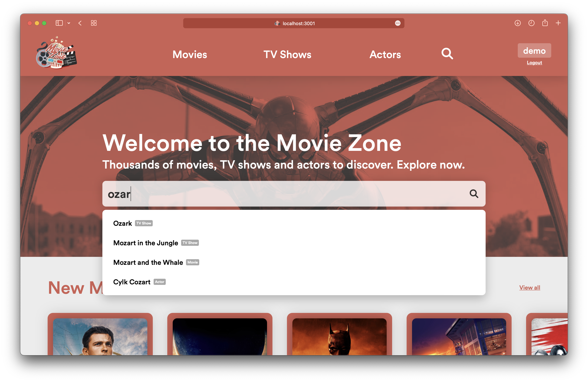

# Movie Zone

### Main features:

- Register and login in order to save movies/TV shows to a custom watchlist
- Uses SQLite3 in order to store about 22,000 movies and 60,000 actors (Last updated: April 2022)
- Includes a powerful and instantaneous searchbar that searches for movies, TV shows and actors based off entered query
- Features multiple ways to discover and filter movies (ex: sort by rating, popularity, release date, etc)

<br />

**Features a beautiful inviting UI**


<br />

**You can login to save movies to your watchlist**



<br />

**Access very thorough filter queries**



<br />

**Search what's popular right now**


<br />

**Gorgeous movie views with complete information**


<br />

**An exhaustive actor view with all the movies they star in**



<br />

**Easily view and edit your watchlist**


<br />

**A powerful and instant searchbar**



<br />

## Run

Every push to `main` builds the image `ghcr.io/taharhidouani/movie-zone` (tags `main` and `sha-<commit>`). The container listens on port 8080, answers `GET /healthz` and serves the React client built for `/projects/movie-zone/` (`homepage` in `client/package.json`).

| Variable | Purpose |
| --- | --- |
| `DB_PATH` | SQLite database file, `/data/moviezone.db` in the image (`moviezone.db` in the working directory otherwise) |
| `SESSION_SECRET` | Random string that signs session cookies; without it sessions reset on every restart |
| `PORT` | Listen port, default 8080 |

```sh
docker run -p 8080:8080 -v movie-zone-data:/data -e SESSION_SECRET=change-me ghcr.io/taharhidouani/movie-zone:main
```

The database lives in the `/data` volume, which must be writable by uid 1000. Create it from the dump with `sqlite3 moviezone.db < server/moviezone.sql`.
